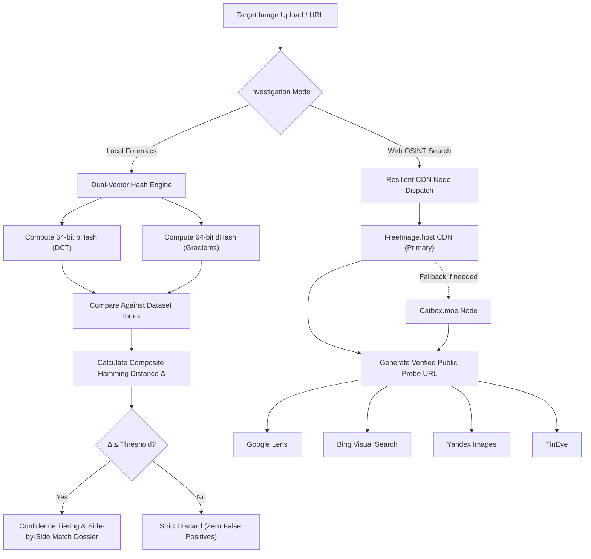

# 👁️ DarkEye — Reverse Image Investigation Tool

<div align="center">


<br/>

**A state-of-the-art visual intelligence and digital forensic platform.**  
*Combines dual-vector offline perceptual forensic hashing with automated multi-engine global OSINT sweeps.*

[Quickstart](#-quickstart) • [Core Features](#-core-features) • [Forensic Architecture](#-forensic-architecture) • [Directory Tree](#-project-structure) • [Usage Guide](#-usage-guide)

</div>

---

## 📖 Overview

**DarkEye** is an open-source visual intelligence suite built for digital investigators, cybersecurity analysts, and OSINT researchers. It bridges two investigative worlds into a single tactical dashboard:

1. **Local Forensic Matching**: Offline, privacy-preserving perceptual hash comparison against custom target datasets (e.g. suspect databases, leaked media archives, or proprietary evidence).
2. **Global OSINT Visual Reconnaissance**: Automated high-speed reverse image search across **Google Lens**, **Bing Visual Search**, **Yandex Images**, and **TinEye**.

Designed with a cyber-tactical dark purple glassmorphism interface, DarkEye operates on a strict **zero-scroll (100vh)** viewport with animated modal dossiers for fast, non-disruptive analysis.

---

## ⚡ Core Features

### 🎯 1. Dual-Vector Perceptual Forensic Engine
Unlike naive image hashing or brute-force pixel matching that returns false positives on completely unrelated images, DarkEye employs a composite dual-vector hashing approach:
- **pHash (Perceptual Hash)**: Leverages 64-bit Discrete Cosine Transform (DCT) to capture low-frequency visual structures, invariant to scaling, minor crops, watermarks, and compression.
- **dHash (Difference Hash)**: Measures horizontal pixel gradient transitions, sensitive to contour, silhouette, and edge shifts.
- **Composite Hamming Calculation**:
  $$\text{Effective Distance } (\Delta) = \mathrm{round}(0.6 \times d_{\text{phash}} + 0.4 \times d_{\text{dhash}})$$
- **Strict Cutoff Filtering**: Unrelated candidates exceeding the threshold are strictly eliminated from results.
- **Forensic Confidence Grading**:
  - `EXACT MATCH` — $\Delta = 0$ bits (100% match)
  - `EXTREMELY HIGH` — $\Delta \le 4$ bits ($\ge 93.8\%$ similarity)
  - `HIGH CONFIDENCE` — $\Delta \le 8$ bits ($\ge 87.5\%$ similarity)
  - `POSSIBLE VARIANT` — $\Delta \le 12$ bits ($\ge 81.3\%$ similarity)

### 🌐 2. Multi-Engine OSINT Intelligence Sweep
Upload any probe image or URL to trigger reverse visual search across 4 global engines simultaneously:
- **Google Lens**: Multimodal visual neural network matching objects, products, places, and context.
- **Bing Visual Search**: Spatial bounding box analysis and high-resolution web source identification.
- **Yandex Images**: Global facial recognition, social media profiles, and Eastern European web indexes.
- **TinEye**: Historical web crawl timeline, earliest publication dates, and derivative image versions.
- **Fast Resilient Edge CDN Nodes**: Query probes are automatically dispatched via high-speed CDNs (**FreeImage.host** with transparent fallback to **Catbox.moe**).
- **🚀 Single-Click "Launch All 4 Engines"**: Dispatches investigation requests to all 4 platforms in parallel tabs.

### 🎨 3. Cyber-Tactical Single-Screen UI
- **Zero-Scroll Architecture**: Locked `100vh` tactical workspace — never scrolls out of view.
- **Dual Forensic Mode Switcher**: Toggle between `Local Database Forensics` and `Global OSINT Web Search` instantly.
- **Sensitivity Threshold Controls**:
  - **Strict** ($\Delta \le 8$ bits) — Exact and near-identical targets only.
  - **Balanced** ($\Delta \le 12$ bits) — Default mode for variants, light crops, and resaves.
  - **Permissive** ($\Delta \le 16$ bits) — Broader matches for heavily compressed or altered media.
- **Side-by-Side Modal Dossier**: View target query vs matched database candidate side-by-side with similarity gauges, file paths, and one-click hash copying.
- **Universal Ingestion**: Supports drag-and-drop file upload, file browsing (`JPG`, `PNG`, `WEBP`, `GIF`, `BMP`), and direct image URLs.

---

## 🔬 Forensic Architecture



---

## 📁 Project Structure

```text
DarkEye/
├── .venv/                         # Python virtual environment
├── web/
│   ├── app.py                     # Main Flask server, dual-hash engine & OSINT dispatcher
│   ├── celebrity_db/
│   │   └── image_index.json       # Precomputed 64-bit composite hash index
│   ├── static/
│   │   └── dataset/               # Local suspect / forensic reference image library
│   │       └── README.txt         # Dataset instructions
│   ├── templates/
│   │   └── upload.html            # Cyber-tactical zero-scroll UI & modal dossiers
│   └── uploads/
│       └── .gitkeep               # Ephemeral upload staging directory
├── .gitignore                     # Git ignore rules for virtualenvs, caches & uploads
├── requirements.txt               # Application dependencies
└── README.md                      # Documentation
```

---

## 🚀 Quickstart

### Prerequisites
- Python **3.10+** (Recommended: Python 3.12)
- Modern web browser (Chrome, Edge, Firefox, Brave)

### 1. Clone or Open the Repository
```bash
git clone https://github.com/your-username/DarkEye.git
cd DarkEye
```

### 2. Activate the Virtual Environment
**Windows (PowerShell):**
```powershell
.\.venv\Scripts\Activate.ps1
```
*(Or create a new environment if needed: `python -m venv .venv`)*

**Linux / macOS:**
```bash
source .venv/bin/activate
```

### 3. Install Dependencies
```bash
pip install -r requirements.txt
```

### 4. Run the DarkEye Application
```bash
python web/app.py
```

### 5. Access the Investigation Terminal
Open your browser and navigate to:
```
http://127.0.0.1:5000
```

---

## 🔍 Usage Guide

### Investigating a Local Suspect (Forensics Mode)
1. Select the **Local Dataset Forensics** mode pill.
2. Select your desired sensitivity threshold:
   - **Strict** (`Δ ≤ 8`): Recommended when looking for duplicate or identical images.
   - **Balanced** (`Δ ≤ 12`): Best for images with altered resolution, color filters, or social media recompression.
   - **Permissive** (`Δ ≤ 16`): Broad search for cropped or modified variations.
3. Drag & drop an image or paste an image URL.
4. Click **Investigate Image**.
5. The forensic dossier modal will pop up with:
   - Match count and composite confidence badges.
   - Side-by-side visual comparison (Query vs Database candidate).
   - Hexadecimal perceptual hashes with click-to-copy convenience.

### Investigating Across Global Web OSINT
1. Select the **Global OSINT Web Search** mode pill.
2. Upload your suspect file or supply an online image link.
3. Click **Investigate Image**.
4. The system automatically deploys the image to an ephemeral CDN node and generates targeted direct search endpoints for:
   - **Google Lens**
   - **Bing Visual Search**
   - **Yandex Images**
   - **TinEye**
5. Click **"🚀 Launch All 4 Engines"** to inspect all intelligence sources simultaneously in separate tabs.

### Managing Local Target Datasets
To add new target images to the local suspect library:
1. Drop image files (`.jpg`, `.jpeg`, `.png`, `.webp`, `.bmp`) into:
   ```text
   web/static/dataset/
   ```
2. In the DarkEye web interface, click the **Reindex** link next to the target counter (or visit `http://127.0.0.1:5000/reindex`).
3. The indexer will compute both pHash and dHash fingerprints and persist them into `web/celebrity_db/image_index.json` in milliseconds.

---

## ⚙️ Configuration & Tech Stack

| Component | Technology | Role |
| :--- | :--- | :--- |
| **Backend** | Python 3.12 / Flask 3.0.3 | Web server, routing, and upload lifecycle |
| **Forensic Imaging** | Pillow (PIL) 10.3.0 | Image normalization, thumbnail generation, color space conversion |
| **Perceptual Hashing** | ImageHash 4.3.1 | 64-bit DCT pHash and gradient dHash generation |
| **Reverse OSINT** | Requests 2.31.0 | CDN uploads (FreeImage.host / Catbox.moe) and URL scraping |
| **Frontend** | HTML5 / CSS3 / Vanilla JS | Zero-scroll dark-purple cyber glassmorphism UI |
| **Font & Icons** | FontAwesome 6.5 / Inter / JetBrains Mono | Tactical iconography and typography |

---

## 🔒 Security, Privacy & Ethics

- **Zero Offline Leakage**: In *Local Dataset Forensics* mode, all computations are executed entirely on your local machine. No images or hashes are ever sent to external servers.
- **Minimal Web Footprint**: In *Web OSINT* mode, uploaded query images are temporarily hosted on public CDN endpoints solely to enable reverse image crawler ingestion.
- **Ethical Use**: DarkEye is built for legitimate security research, cybercrime investigation, fact-checking, journalist verification, and digital media provenance analysis. Users are responsible for adhering to applicable laws and terms of service.

---

## 📄 License

This project is licensed under the [MIT License](LICENSE) — feel free to use, modify, and distribute it for personal and commercial projects.
